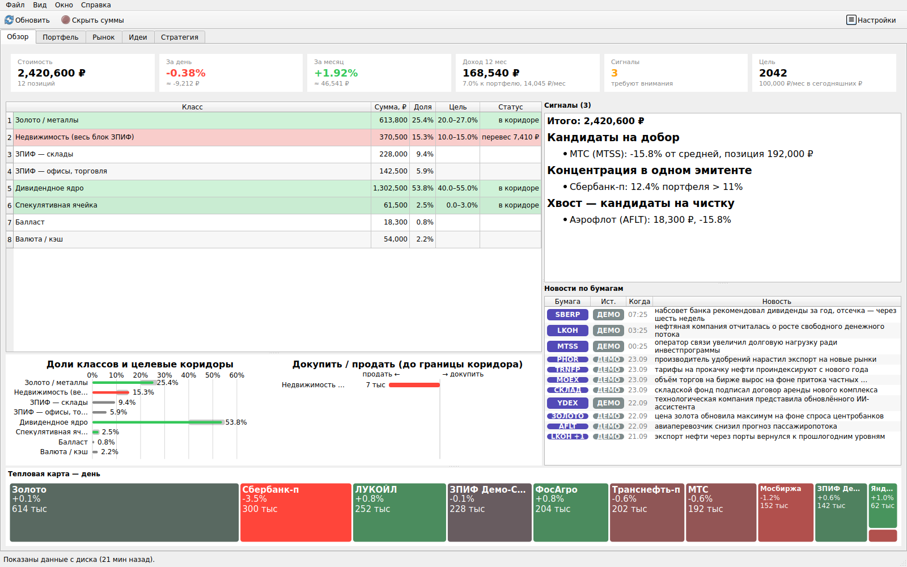

# PortfolioCheck

Настольное приложение для macOS, Windows и Linux, которое сверяет портфель в **Т-Инвестициях** с твоими собственными правилами:
целевыми долями классов активов, лимитами на эмитентов, правилами добора — и подсвечивает отклонения.
Плюс тепловые карты, новости по твоим бумагам, скринер дивидендных идей и калькулятор «иду ли я по плану».

> **Не является инвестиционной рекомендацией.** Программа только считает и показывает. Решения принимаешь ты.
> Токен T-Invest API используется в режиме «только чтение» — программа не может совершать сделки.



<sub>Снимок сделан в режиме `--demo` на вымышленном портфеле.</sub>

## Что умеет

- **Обзор** — стоимость, изменение за день и месяц, доход за 12 месяцев, доли классов против твоих коридоров,
  что докупить или где перевес, сработавшие правила, новости по бумагам, дневная тепловая карта.
- **Портфель** — позиции с разбивкой по валютам, компаниям и отраслям; заблокированные бумаги с тремя оценками
  (у брокера, на внебирже, «реальная» по эталонному тикеру) и потерей при продаже.
- **Риск** (на экране «Портфель») — за год: волатильность портфеля, максимальная просадка сегодняшнего состава,
  эффективное число бумаг, во сколько раз диверсификация гасит риск, вклад каждой бумаги в риск и самые связанные
  пары. Описание прошлого, не прогноз.
- **Сценарии** (на экране «Портфель») — «индекс −30%», «рубль −20%» и свои значения: оценка изменения стоимости
  по классам и бумагам через чувствительность (β) к индексу Мосбиржи и доллару за прошлый год. Ориентир масштаба,
  не прогноз; индекс — MOEX ISS, курс доллара — T-Invest (запасной — ЦБ). Если один ряд не загрузился, оценка
  идёт по второму — это подписано.
- **Карточка бумаги** — двойной клик по бумаге в любой таблице: график цены за год, изменения по периодам,
  позиция и её место в правилах (лимит на эмитента, коридор класса), выплаты, фундаментал и **сравнение с
  медианой отрасли** (дивдоходность, P/E, долг/EBITDA, ROE…), новости, оценка ИИ; справочно — консенсус-прогноз
  аналитиков из T-Invest (целевая цена, разброс, взгляды домов).
- **Календарь** — ближайшие отсечки и выплаты по портфелю с последним днём покупки, денежный поток по месяцам
  на год вперёд (✔ объявлена, ≈ ожидается по прошлому году, ✓ была — слово в подсказке), ближайшие выплаты
  кандидатов скринера (из T-Invest, как по портфелю), **календарь ЦБ по ключевой ставке** на полгода (заседания, резюме обсуждения; с сайта ЦБ, раз в неделю).
- **Рынок** — слева тепловая карта с группировкой по отраслям (день / неделя / месяц / год / дивиденды за 12 мес),
  справа лента новостей из RSS деловых СМИ и ИИ-сводка. К бумаге новость привязывается по названию и алиасам;
  спорт не учитывается, блоги smart-lab — только по заголовку, сообщения Мосбиржи — только если в них есть
  твоя бумага. Время — местное.
- **Идеи** — скринер дивидендных акций по фундаменталу T-Invest (дивдоходность, капитализация, долг/EBITDA,
  средняя доходность за 5 лет) с изменением за месяц и тональностью новостей.
- **Откуда изменение** (на экране «Стратегия») — за месяц / квартал / год / всё время: сколько дала переоценка,
  а сколько — покупки (пополнения и реинвест), по классам и крупнейшим бумагам; выплаты периода — справочно.
- **Стратегия** — прогноз пассивного дохода на сложном проценте с реинвестом, инфляцией и пополнениями;
  блок «Где я сейчас» как ипотечный калькулятор: опережение или отставание от плана и какой взнос нужен,
  чтобы успеть к выбранному году. Доходность новых денег и переоценка считаются из портфеля по твоим целевым
  долям (с учётом того, что часть денег уходит в золото, которое не платит).
- **ИИ-сводки** (по желанию) — тональность новостей по бумагам и короткие выводы «хорошо / плохо / следить»
  на каждом экране. Провайдеры: OpenRouter, Claude, Qwen (Alibaba), любой OpenAI-совместимый, Ollama локально.
- Режим «глазик» (⌘⇧H, на Windows/Linux — Ctrl+Shift+H) скрывает все суммы — удобно показывать экран другим.
- **Оповещения** (Настройки → Оповещения), пока программа открыта: цена бумаги ≥ / ≤ уровня, дивдоходность
  кандидата, N дней до последнего дня покупки под выплату, выход класса из коридора, свежая новость по бумаге, N дней до заседания ЦБ по ставке —
  системное уведомление, по одному разу на событие; последние — в панели «Сигналы».
- **Экспорт в CSV** — правый клик по любой таблице и «Файл → Экспорт истории стоимости»: формат под русский Excel
  (разделитель «;», десятичная запятая), открывается двойным кликом.
- **Сеть** (кнопка в панели инструментов) — крутится, пока идёт обмен: портфель, свечи, новости, скринер, ИИ-сводки.
  По клику — окно с шагами: ожидает / выполняется (сколько секунд) / повтор через N с / готово / ошибка / таймаут,
  с текстом ошибки и последними завершёнными задачами. ✗ на кнопке — последняя задача не удалась.
- **Палитра ⌘K** (Ctrl+K) — одна строка для всего: тикер, название или отрасль → карточка бумаги, «SBERP новости» →
  лента по бумаге, «идеи», «обновить», «настройки скринер», «лог»…
- Экраны переключаются ⌘1…⌘6, обновление — ⌘R (и F5), настройки — ⌘, (на Windows/Linux — те же сочетания с Ctrl).
  «О программе», лог и проверка подключений — в меню «Справка» (на macOS «О программе» и «Настройки» — в меню
  приложения).

## Принципы стратегии

Программа построена вокруг нескольких принципов; шаблоны в мастере отличаются только цифрами:

1. Портфель — это классы с целевыми коридорами; решения принимаются по отклонению от коридора.
2. Защитное ядро (золото/металлы) держится всегда, независимо от рынка.
3. Основа денежного потока — дивидендное ядро и доходная недвижимость (ЗПИФ), а не ставка на рост.
4. Спекуляции — в отдельной маленькой ячейке с жёстким потолком.
5. Концентрация ограничена: ни один эмитент не больше заданной доли портфеля.
6. Добор — по правилу (просадка от средней), а не по эмоции; проблемные бумаги можно «заморозить».
7. От чего отказался осознанно — в чёрный список скринера с причиной.
8. Программа считает и подсвечивает; решения принимает человек.

## Установка — готовые сборки

Страница **Releases** репозитория — сборки для трёх ОС. Их собирает GitHub Actions при публикации релиза
(`.github/workflows/release.yml`); промежуточные сборки — в артефактах CI (Actions → запуск → Artifacts).
Подписи кода пока нет, поэтому первый запуск на macOS и Windows требует одного подтверждения.

| ОС | файл | установка |
|---|---|---|
| macOS 12+, Apple Silicon (M1 и новее) | `PortfolioCheck-<версия>.dmg` | перетащить в «Программы»; первый запуск — правый клик → «Открыть» |
| Windows 10/11 x64 | `PortfolioCheck-windows.zip` | распаковать, запустить `PortfolioCheck.exe`; SmartScreen: «Подробнее» → «Выполнить в любом случае» |
| Linux x86_64 (glibc 2.35+: Ubuntu 22.04+, Debian 12+, Fedora 36+) | `PortfolioCheck-linux-x86_64.tar.gz` | распаковать, `./PortfolioCheck/PortfolioCheck`; ярлык в меню — `./PortfolioCheck/install.sh` |

Сборка для macOS — только под Apple Silicon: релиз собирается на ARM-машине GitHub, а PyInstaller упаковывает скомпилированные библиотеки (Python, Qt, grpcio) той архитектуры, на которой шла сборка. На Mac с Intel dmg из релиза не запустится — соберите сами: `./build_mac.sh` (см. «Сборка из исходников») даст сборку под Intel.

На Linux для Qt нужны системные библиотеки (обычно уже стоят в графическом окружении; если программа не
стартует — `sudo apt install libxcb-cursor0 libxkbcommon-x11-0 libegl1`).

## Сборка из исходников

Нужен Python 3.12. SDK T-Invest ставится с GitHub (пакет с PyPI удалён) — это делают `setup_env.sh` и команды
ниже. Тесты для разработчика: `pip install -r requirements-dev.txt`, затем `python -m pytest`.

### macOS

```bash
git clone https://github.com/jfoboss/PortfolioCheck.git && cd PortfolioCheck
./bootstrap_mac.sh            # Python 3.12 через Homebrew (если нужно), .venv, зависимости
.venv/bin/python src/app.py   # запуск из исходников
./build_mac.sh                # dist/PortfolioCheck.app и dist/PortfolioCheck-<версия>.dmg
```

Сборка подписывается ad-hoc (или самоподписанным сертификатом «PortfolioCheck» из Keychain, если он есть —
тогда Keychain не спрашивает доступ после каждой пересборки).

### Windows (PowerShell)

```powershell
winget install Python.Python.3.12 Git.Git       # если ещё не стоят
git clone https://github.com/jfoboss/PortfolioCheck.git; cd PortfolioCheck
py -3.12 -m venv .venv
.venv\Scripts\pip install --no-deps "git+https://github.com/RussianInvestments/invest-python.git"
.venv\Scripts\pip install -r requirements.txt pillow
.venv\Scripts\python src\app.py                  # запуск из исходников
.venv\Scripts\python build.py                    # dist\PortfolioCheck\PortfolioCheck.exe и dist\PortfolioCheck-windows.zip
```

### Linux (Ubuntu / Debian)

```bash
sudo apt install python3.12 python3.12-venv git libegl1 libxkbcommon-x11-0 libxcb-cursor0
git clone https://github.com/jfoboss/PortfolioCheck.git && cd PortfolioCheck
python3.12 -m venv .venv && source .venv/bin/activate && bash setup_env.sh
python src/app.py             # запуск из исходников
python build.py               # dist/PortfolioCheck/ и dist/PortfolioCheck-linux-x86_64.tar.gz
```

Где Python 3.12 нет в репозиториях (Ubuntu 22.04) — через `pyenv` или PPA deadsnakes. Для хранения токена
нужна служба Secret Service (GNOME Keyring или KWallet); без неё токен сохраняется в файл с правами 600.

## Первый запуск

0. **Сначала — демо.** Пока нет токена и своих данных, программа открывается на вымышленном портфеле: все экраны
   заполнены, можно всё посмотреть. Кнопка **«Настроить…»** на панели переключает на свой профиль и запускает
   мастер; после настройки на панели появляются обычные кнопки.
1. **Мастер настройки** откроется сам: принципы → шаблон стратегии (дивидендная с защитным ядром,
   консервативная, активная или «задать самому») → коридоры → правила → цель. Всё меняется потом в Настройках;
   мастер можно запустить снова: «Файл → Мастер настройки…».
2. **Токен T-Invest API** — только чтение: Т-Инвестиции → Настройки → Токены T-Invest API.
   В программе: Настройки → Доступ → «Задать токен» и «Собрать бандл» (корневые сертификаты для подключения).
   Бандл — файл в папке данных программы: в Keychain / хранилище Windows / системные сертификаты Linux ничего
   не устанавливается. Корень Минцифры из него программа использует и для сайтов (ленты, ЦБ), если какой-то из
   них перейдёт на российский сертификат; остальные сайты проверяются по сертификатам ОС, как в браузере.
   Токен хранится в системном хранилище: Keychain (macOS), диспетчер учётных данных (Windows),
   Secret Service (Linux).
3. После первого обновления бумаги **классифицируются автоматически**: акции — в дивидендное ядро, золото — в
   металлы, ЗПИФ — в недвижимость, иностранные — отдельно. Такие классы подсвечены оранжевым в
   Настройки → Инструменты — проверь их: спекулятивную ячейку и балласт программа сама не отличит.

### Помощь со стратегией через ChatGPT

Кнопка **«Скопировать промпт для ChatGPT»** (в мастере и в Настройки → Общие) кладёт в буфер промпт из
[`docs/CHATGPT_PROMPT.md`](docs/CHATGPT_PROMPT.md). Вставь его в новый чат: модель расспросит о целях, горизонте
и отношении к просадкам, поможет разнести бумаги по классам и выдаст файл стратегии в YAML. Сохрани ответ в файл
и загрузи: **Настройки → Общие → «Импорт стратегии…»**. Импорт проверяет файл (известные классы, совместимость
коридоров) и показывает, какие разделы будут заменены.

Стратегией можно делиться: «Экспорт стратегии…» сохраняет правила, коридоры и классификацию без токена,
id счёта и личных сумм.

## Где хранятся данные

| | macOS | Windows | Linux |
|---|---|---|---|
| настройки, снапшоты, кэш, лог | `~/Library/Application Support/PortfolioCheck/` | `%APPDATA%\PortfolioCheck\` | `~/.local/share/PortfolioCheck/` |
| токен и ключи ИИ | Keychain | диспетчер учётных данных | Secret Service (GNOME Keyring / KWallet) |

- Папку данных можно перенести (Настройки → Общие): на macOS — в iCloud Drive, на любой ОС — в свою папку
  (OneDrive, Dropbox, Яндекс Диск…), чтобы работать с нескольких компьютеров. Токен в общую папку не попадает —
  он вводится на каждом компьютере один раз.
- Если системное хранилище секретов недоступно — токен в файле с правами только для владельца.
- Формат настроек версионируется: после обновления программы старый `config.yaml` обновляется сам, а рядом
  остаётся копия прежнего файла `config.yaml.v<N>.bak` — ничего из настроек при этом не теряется.
- Лог и диагностика — меню «Справка» → «Диагностика и лог…» (кнопки «Проверить подключения» и
  «Скопировать диагностику» — в диагностике нет токена и сумм).

Если macOS не даёт доступ к iCloud Drive, приложение работает локально и показывает баннер с кнопкой в нужный
раздел системных настроек (Конфиденциальность и безопасность → Полный доступ к диску).

## ИИ-сводки

Настройки → ИИ. По умолчанию — OpenRouter: ключ создаётся за минуту без верификации. Модель выбирается из
выпадающего списка: каталог OpenRouter грузится без ключа и кэшируется на сутки, работает поиск по подстроке,
галочка «только бесплатные», звёздочкой ★ отмечены рекомендуемые (семейства, которые надёжно отвечают в JSON и
пишут по-русски, контекст от 32k, бесплатные или дешёвые). Если поле пустое, берётся первая рекомендуемая
бесплатная модель из текущего каталога — бесплатные версии OpenRouter снимает без предупреждения, поэтому
зашитой в код модели нет.

**Лимиты бесплатных моделей.** У `:free`-моделей OpenRouter общий лимит на аккаунт: 20 запросов в минуту и
50 в сутки, после покупки кредитов от $10 — 1000 в сутки. Смена модели при исчерпанном дневном лимите не помогает.
Программа экономит запросы: одно обновление тратит 2 (сводка новостей и все экраны одним запросом), ответы
кэшируются. На 429 она разбирает ответ и пишет, что именно случилось: дневной лимит аккаунта (с временем сброса —
до него запросы к бесплатным моделям не отправляются, в том числе после перезапуска программы), лимит в минуту или перегрузка провайдера модели (тогда
OpenRouter сам пробует запасные бесплатные модели, а программа через 10 секунд повторяет запрос один раз — это ещё
один запрос из лимита). В шапке сводки — модель, которая ответила на самом деле (может быть запасной). При запуске
сводка берётся только из кэша; запрос уходит, когда загрузится свежая лента. Статус ключа — куплены ли кредиты —
показан в настройках.
Кнопка «Проверить» рядом с ключом за один запрос проверяет выбранную модель: отвечает ли она строгим JSON по схеме
и по-русски (это нужно для сводок) и не ошибается ли в простых вопросах. Результат запоминается для каждой модели —
★ в списке остаётся эвристикой, а проверка показывает, как модель ведёт себя на деле.
Подписка Claude Pro/Max доступ к API не включает — это отдельный баланс. Без ключа ИИ-панели просто скрыты.

## Устройство

Python 3.12, PySide6 (Qt), [tinkoff-investments](https://github.com/RussianInvestments/invest-python) (gRPC),
графики нарисованы на QPainter. Ядро (`portfolio_check.py`, `history.py`, `news.py`, `screener.py`, `ai.py`,
`strategy.py`, `forecast.py`) не зависит от интерфейса и тестируется отдельно.

Исходники — в `src/` (в корне — README, скрипты сборки, `docs/`, `tests/`).

| файл (в `src/`) | что внутри |
|---|---|
| `app.py`, `screens/`, `workers.py`, `widgets.py`, `ui_common.py` | главное окно, экраны, фоновые загрузки |
| `portfolio_check.py` | загрузка портфеля из API, классы, правила, отчёт |
| `strategy.py` | шаблоны стратегий, автоклассификация, импорт/экспорт |
| `wizard.py` | мастер первого запуска |
| `forecast.py` | прогноз и «Где я сейчас» |
| `history.py`, `news.py`, `screener.py`, `macro.py`, `ai.py` | свечи, RSS, скринер, данные ЦБ, ИИ |
| `payouts.py`, `screens/payouts.py`, `screens/card.py` | календарь выплат, карточка бумаги |
| `settings_dialog.py`, `diagnostics.py` | настройки, диагностика |
| `paths.py`, `secrets_store.py`, `osutil.py` | папки данных, хранилище секретов, различия ОС |
| `config_migrate.py` | версия конфига и миграции между версиями |
| `demo.py` | режим `--demo`: вымышленный портфель во временной папке |
| `build_mac.sh`, `bootstrap_mac.sh` | macOS: сборка .app/.dmg и подготовка окружения |
| `build.py` | Windows и Linux: сборка zip / tar.gz |
| `.github/workflows/` | CI (тесты на трёх ОС, сборки, дымовой запуск) и релизы |

## Ограничения

- Основная платформа автора — macOS. Windows и Linux проверяются в CI (тесты, сборка, запуск собранной программы),
  ручных прогонов на живых машинах меньше — о проблемах пиши в Issues.
- Подписи кода нет: предупреждения при первом запуске на macOS и Windows.
- Данные — T-Invest API; другие брокеры не поддерживаются.
- История стоимости до первого запуска восстанавливается приближённо: сегодняшний состав по ценам прошлых дней.
- Тональность новостей и сводки — оценка заголовков моделью, а не анализ отчётности.

## Разработка

```bash
pip install -r requirements-dev.txt  # в активированном .venv
python -m pytest                     # тесты: offscreen, без сети, на демо-данных; CI гоняет их на трёх ОС
bash scripts/check_private.sh        # перед push: нет ли личных данных в исходниках (и какие картинки не просмотрены)
python src/app.py --demo             # вымышленный портфель без токена; настоящий профиль не трогается
```

Документация для разработчика и агента (Claude Code): `CLAUDE.md`, `docs/ARCHITECTURE.md`, `docs/DECISIONS.md`,
`docs/LESSONS.md`, `docs/BACKLOG.md`, `docs/TESTING.md`, `docs/CROSS_PLATFORM.md`, `docs/TERMINAL_IDEAS.md`, правила по областям кода — `.claude/rules/`.

## Лицензия

MIT — см. [LICENSE](LICENSE).
